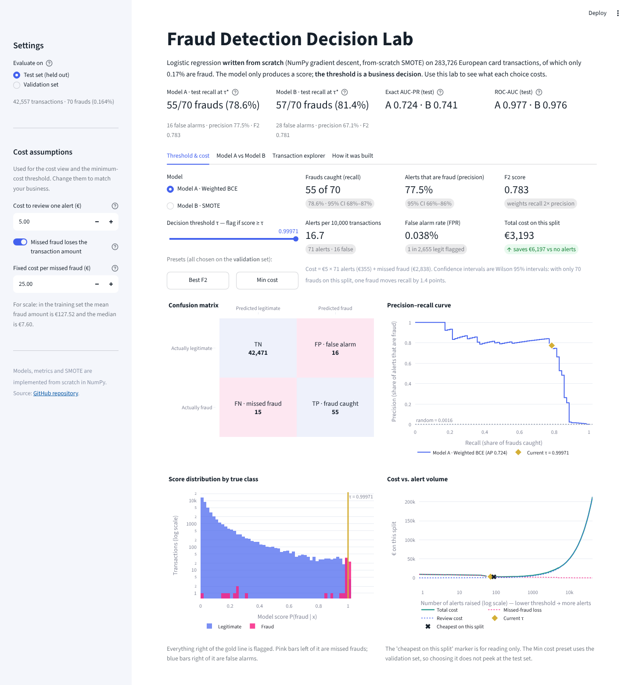

# Fraud Detection Decision Lab (Streamlit)

An interactive front end for the from-scratch logistic regression in
[`../notebook`](../notebook). The app re-runs the trained models live from their saved
weights (NumPy only, no scikit-learn at runtime) and treats the threshold as a business decision
rather than a constant.



## What it shows

| Tab | What you can do |
|---|---|
| **Threshold & cost** | Drag τ and see recall, precision, F2, false-alarm rate, alerts per 10,000 transactions and total cost update live, with Wilson 95% intervals. Presets jump to the notebook's τ\* (best F2) or the minimum-cost τ, both chosen on **validation** so the test set is never used for selection. Includes the confusion matrix, the PR curve with the operating point marked, the score distribution by class, and cost vs alert volume. |
| **Model A vs Model B** | Weighted BCE vs SMOTE side by side: metrics table, PR curves, ROC on a log false-positive axis, and whether the two models catch the *same* frauds. |
| **Transaction explorer** | Pick a real held-out transaction (missed frauds, caught frauds, false alarms, or the most confident legitimate ones) and see both scores against the threshold, plus an exact logit breakdown: `logit = bias + Σ wⱼ·zⱼ`. |
| **How it was built** | Pipeline summary, training curves, reliability diagram, learned weights, and how the app's numbers reconcile with the notebook. |

There is deliberately no raw-feature input form: V1–V28 are anonymised PCA components, so typed-in
values would be meaningless. The explorer uses real transactions instead.

The cost model is `review cost × alerts + Σ over missed frauds (fixed fee + amount, optional)`.
All three inputs live in the sidebar.

## Run it locally

```bash
cd "1. Supervised_Learning/02. logistic_regression_credit_card_fraud/app"
python -m venv .venv && source .venv/bin/activate     # Windows: .venv\Scripts\activate
pip install -r requirements.txt
streamlit run app.py
```

The trained models and the validation/test splits are committed in `artifacts/` (about 19 MB),
so the app starts without downloading the dataset or retraining.

## Rebuild the artifacts

`build_artifacts.py` repeats the notebook pipeline exactly (same seeds, split, normalisation,
SMOTE, training and F2 threshold search). It refuses to save if the operating points differ from
the notebook's (τ\* = 0.99971 / 0.79094; on test, Model A catches 55 of 70 frauds with 16 false
alarms and Model B catches 57 with 28).

```bash
python build_artifacts.py                          # downloads creditcard.csv (~150 MB)
python build_artifacts.py --csv path/to/creditcard.csv
```

It takes about 90 seconds and writes `artifacts/model.npz`, `artifacts/eval_data.npz` and
`artifacts/meta.json`.

## Tests

```bash
pip install -r requirements-dev.txt
pytest -q
```

- `test_metrics.py`: every from-scratch metric (counts, exact AP, ROC-AUC, F-beta optimum, cost curve, Wilson interval) checked against scikit-learn or hand-computed values.
- `test_reproduction.py`: the saved models reproduce the notebook's operating points and split sizes, the logit decomposition reconstructs each probability exactly, and the gradient check passes.
- `test_app.py`: drives every control in the UI headlessly (both models, all presets, τ = 0 and 1, both splits, extreme costs, every explorer group) and asserts nothing raises.

## Deploy on Streamlit Community Cloud

1. Push this repository to GitHub (already done if you're reading this there).
2. At [share.streamlit.io](https://share.streamlit.io), choose **Create app → Deploy a public app from GitHub**.
3. Pick this repository and the `main` branch, and set **Main file path** to
   `1. Supervised_Learning/02. logistic_regression_credit_card_fraud/app/app.py`.
4. Deploy. Community Cloud installs `requirements.txt` from the app's own folder.

Community Cloud reads `.streamlit/config.toml` only from the repository root, so the hosted app
uses Streamlit's default theme unless you copy `app/.streamlit/config.toml` there. Nothing else
depends on it.

## Exactness

- **Scores match the notebook bit for bit.** The evaluation data is stored at full float64 precision
  and the logit is computed in the notebook's operation order, so a transaction sitting exactly at
  τ\* stays on the same side of it. A test asserts that τ\* is exactly the F2-optimal validation score.
- **AUC-PR is exact average precision** (0.724 for A, 0.741 for B on test), the same definition the
  notebook uses. An earlier version of the notebook integrated over a 300-point grid, which missed
  Model A's scores above 0.99 and reported 0.558.
- **Some Model A scores are exactly 1.0** (the sigmoid saturates in float64), so even τ = 1.0 flags
  them. When flagging nothing is the cheapest option, the *Min cost* preset is disabled and the app
  says why.
- **Calibration.** Both models over-predict fraud (class weighting and SMOTE train on a world where
  fraud is far more common than 0.17%), so the app treats scores as rankings, not probabilities.

## Layout

```
app/
├── app.py                 # Streamlit UI
├── build_artifacts.py     # notebook pipeline → artifacts/
├── fraudlab/
│   ├── model.py           # from-scratch inference + logit decomposition
│   └── metrics.py         # exact sweeps, AP, ROC-AUC, cost curve, Wilson CI, calibration
├── artifacts/             # model.npz, eval_data.npz, meta.json
├── tests/
├── assets/screenshot.png
├── requirements.txt
└── requirements-dev.txt
```
